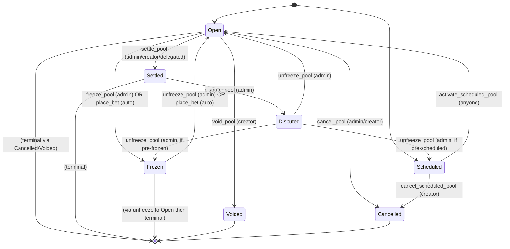

# Market Lifecycle State Machine

## Statuses

The market (pool) can be in one of the following statuses:

- **Open**: Accepting bets; expiry has not yet passed.
- **Settled(u32)**: Betting closed and a winning outcome has been declared. The u32 is the index of the winning outcome.
- **Voided**: Creator voided the pool; all participants can claim a full refund.
- **Frozen**: Pool is temporarily frozen, blocking bets and claims.
- **Disputed**: Pool settlement is disputed, blocking claims pending review.
- **Cancelled**: Creator cancelled the pool before any bet was placed. Terminal.
- **Scheduled(u64)**: Pool parameters are stored but betting opens at this timestamp (u64).

## Transitions

### Open → Cancelled
- **Trigger**: Emergency cancellation by admin or creator cancellation (if Open and no bets placed).
- **Functions**: `cancel_pool`
- **Permission**: Admin or creator (if pool is Open)
- **Automatic**: No
- **File:line**: `contracts/predinex/src/lib.rs:5503`

### Open → Voided
- **Trigger**: Creator voids the pool.
- **Functions**: `void_pool`
- **Permission**: Creator
- **Automatic**: No
- **File:line**: `contracts/predinex/src/lib.rs:6083`

### Open → Frozen
- **Trigger**: 
  - Manual freeze by freeze admin.
  - Automatic when a bet causes the pool to exceed a large pool threshold (cooling period starts).
- **Functions**: 
  - Manual: `freeze_pool`
  - Automatic: Side effect of `place_bet`
- **Permission**: 
  - Manual: Freeze admin
  - Automatic: Any caller placing a bet (trigger is the bet, status change is automatic)
- **Automatic**: Yes (via place_bet when conditions met)
- **File:line**: 
  - Manual: `contracts/predinex/src/lib.rs:7793`
  - Automatic: `contracts/predinex/src/lib.rs:5084`

### Open → Settled
- **Trigger**: Pool expires and is settled by authorized party.
- **Functions**: `settle_pool` (calls `settle_single_pool`)
- **Permission**: Admin, creator, or delegated settler
- **Automatic**: No (requires explicit call, though pool must be expired)
- **File:line**: `contracts/predinex/src/lib.rs:6019`

### Scheduled → Open
- **Trigger**: Scheduled pool's open time is reached; anyone can activate it.
- **Functions**: `activate_scheduled_pool`
- **Permission**: Permissionless (anyone can call once time reached)
- **Automatic**: No (requires explicit call)
- **File:line**: `contracts/predinex/src/lib.rs:4476`

### Scheduled → Cancelled
- **Trigger**: Creator cancels the scheduled pool before it opens.
- **Functions**: `cancel_scheduled_pool`
- **Permission**: Creator
- **Automatic**: No
- **File:line**: `contracts/predinex/src/lib.rs:4533`

### Settled → Disputed
- **Trigger**: Freeze admin disputes the settlement within the dispute window.
- **Functions**: `dispute_pool`
- **Permission**: Freee admin
- **Automatic**: No
- **File:line**: `contracts/predinex/src/lib.rs:7855`

### Frozen → Open
- **Trigger**: 
  - Manual unfreeze by freeze admin.
  - Automatic when cooling period elapses and a bet is placed.
- **Functions**: 
  - Manual: `unfreeze_pool`
  - Automatic: Side effect of `place_bet`
- **Permission**: 
  - Manual: Freeze admin
  - Automatic: Any caller placing a bet (after cooling period)
- **Automatic**: Yes (via place_bet when cooling period elapsed)
- **File:line**: 
  - Manual: `contracts/predinex/src/lib.rs:7931`
  - Automatic: `contracts/predinex/src/lib.rs:4678`

### Disputed → [Pre-dispute Status]
- **Trigger**: Freeze admin unfreezes a disputed pool, restoring it to its pre-dispute status (usually Open).
- **Functions**: `unfreeze_pool` (when pool is Disputed)
- **Permission**: Freeze admin
- **Automatic**: No
- **File:line**: `contracts/predinex/src/lib.rs:7931` (same as unfreeze_pool, see lines 7945-7951)

## State Diagram

Note: The diagram shows the main transitions. The automatic transitions via `place_bet` are labeled as such.

## Transition Summary Table

| Transition | Who can trigger | Automatic? | File:line |
|------------|-----------------|------------|-----------|
| Open → Cancelled | Admin or creator (if Open) | No | `contracts/predinex/src/lib.rs:5503` (`cancel_pool`) |
| Open → Voided | Creator | No | `contracts/predinex/src/lib.rs:6083` (`void_pool`) |
| Open → Frozen (manual) | Freeze admin | No | `contracts/predinex/src/lib.rs:7793` (`freeze_pool`) |
| Open → Frozen (auto) | Any bettor (via place_bet) | Yes | `contracts/predinex/src/lib.rs:5084` (in `place_bet`) |
| Open → Settled | Admin, creator, or delegated settler | No | `contracts/predinex/src/lib.rs:6019` (`settle_pool`) |
| Scheduled → Open | Anyone (once time reached) | No | `contracts/predinex/src/lib.rs:4476` (`activate_scheduled_pool`) |
| Scheduled → Cancelled | Creator | No | `contracts/predinex/src/lib.rs:4533` (`cancel_scheduled_pool`) |
| Settled → Disputed | Freeze admin | No | `contracts/predinex/src/lib.rs:7855` (`dispute_pool`) |
| Frozen → Open (manual) | Freeze admin | No | `contracts/predinex/src/lib.rs:7931` (`unfreeze_pool`) |
| Frozen → Open (auto) | Any bettor (via place_bet after cooling) | Yes | `contracts/predinex/src/lib.rs:4678` (in `place_bet`) |
| Disputed → Open | Freeze admin | No | `contracts/predinex/src/lib.rs:7931` (`unfreeze_pool`, see lines 7945-7951) |

## Notes

- The `Settled` status includes the winning outcome as a parameter (`u32`).
- The `Scheduled` status includes the open timestamp as a parameter (`u64`).
- Terminal states: `Cancelled`, `Voided`, and `Settled` (though `Settled` can transition to `Disputed`, after which it is no longer settled).
- Automatic transitions occur as side effects of the `place_bet` function when specific conditions are met (pool size threshold for freezing, cooling period elapsed for unfreezing).